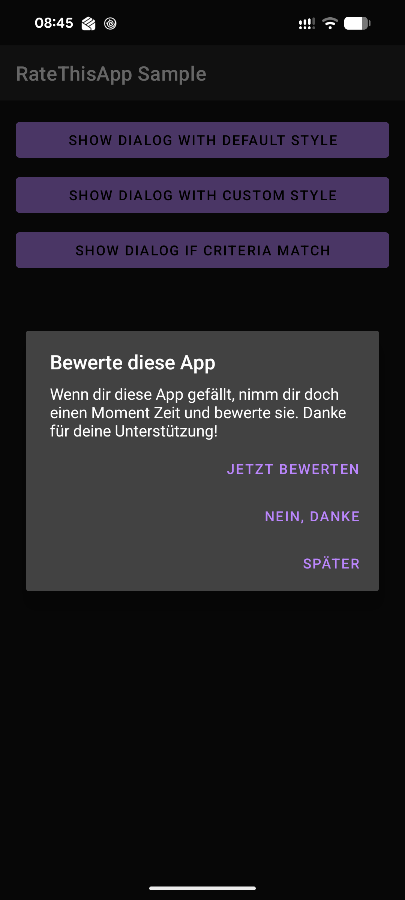

Android-RateThisApp - ENHANCED
===================

Android-RateThisApp is a library to show "Rate this app" dialog ENHANCED.



The library monitors the following status

* How many times is the app launched
* How many days have passed since the app was installed
* **Works with all app markets (GOOGLE, AMAZON, SAMSUNG, HUAWEI)**

and show a dialog to engage users to rate the app in Google Play, Amazon AppStore, Samsung Galaxy and Huawei.

## Getting Started

### Dependency

```groovy
repositories {
    maven { url 'https://jitpack.io' }
}
```

```groovy
dependencies {
    implementation 'com.github.soenkegissel:Android-RateThisApp:2.1.1'
}
```

## Basic usage

### Application class

Initialize RateThisApp once on Application start. Further calls of `initialize` are ignored.
```java
public class MainApplication extends Application {
    
    @Override
    public void onCreate() {
        super.onCreate();
        
        //Use with context, default config (7 days and 10 launches) and a Market (Google, Amazon, Samsung, Huawei).
        RateThisApp.initialize(this, Market.SAMSUNG);
        
        //Use with custom config and Google as Market.
        Config config = new Config(3, 5, Config.Operator.OR);
        RateThisApp.initialize(this, config, Market.GOOGLE);
        
        //Use with Gradle buildConfigField of your app (see below)
        RateThisApp.initialize(this, config, Market.fromName(BuildConfig.MARKET));
    }
}
```

### build.gradle (:app)

To support multiple markets efficiently, define a `flavorDimension` and `productFlavors` in your `build.gradle` file.

```groovy
android {
    ...
    flavorDimensions = ["vendor"]
    productFlavors {
        google {
            dimension "vendor"
            buildConfigField "String", "MARKET", "\"GOOGLE\""
        }
        amazon {
            dimension "vendor"
            buildConfigField "String", "MARKET", "\"AMAZON\""
        }
        samsung {
            dimension "vendor"
            buildConfigField "String", "MARKET", "\"SAMSUNG\""
        }
        huawei {
            dimension "vendor"
            buildConfigField "String", "MARKET", "\"HUAWEI\""
        }
    }
}
```

### Activity class

The most simple setup is to show the dialog if conditions match.

```java
private void ratingMethod() {
    RateThisApp.getInstance(this).showRateDialogIfNeeded(false);
}
```

That's all! You can see "Rate this app" dialog at an appropriate timing.

## Advanced usages

### Show if conditions met
```java
RateThisApp.getInstance(this).showRateDialogIfNeeded(false);
```

### Force dialog to show
```java
RateThisApp.getInstance(this).showRateDialogIfNeeded(true);
```

### Custom style
```java
RateThisApp.getInstance(this).showRateDialogIfNeeded(R.style.MyAlertDialogStyle2, false);
```

### Custom condition

In default, the dialog will be shown when **any of** (usage of Operator.OR) or **all of** (usage of Operator.AND) the following conditions are satisfied.

* App is launched 7 days or more after installation (or after the user pressed "Later").
* App is launched 10 times or more (process starts, counted since installation or the last "Later").

If you want to use your own condition, call `Config config = new Config(3,5, Config.Operator.AND)` 
in your Application class method.

```java

public class MainApplication extends Application {

// Custom condition: 3 days and 5 launches. Both of which must be satisfied.
    @Override
    public void onCreate() {
        super.onCreate();
        
        Config config = new Config(3, 5, Config.Operator.AND);
        RateThisApp.initialize(this, config, Market.GOOGLE);
    }
}
```

### Custom strings

You can override title, message and button labels in your values.xml.

```xml
    <string name="rta_dialog_title">My custom title</string>
    <string name="rta_dialog_message">My custom message</string>
    <string name="rta_dialog_ok">Rate me</string>
    <string name="rta_dialog_cancel">Later</string>
    <string name="rta_dialog_no">No, dude</string>
```

### Opt out from your code

If you want to stop showing the rate dialog, use this method in your code.

```java
RateThisApp.getInstance(this).stopRateDialog();
```

### Callback

You can receive yes/no/cancel button click events.

```java
RateThisApp.getInstance(this).setCallback(new Callback() {
    @Override
    public void onYesClicked() {
        Toast.makeText(MainActivity.this, "Yes event", Toast.LENGTH_SHORT).show();
    }

    @Override
    public void onNoClicked() {
        Toast.makeText(MainActivity.this, "No event", Toast.LENGTH_SHORT).show();
    }

    @Override
    public void onLaterClicked() {
        Toast.makeText(MainActivity.this, "Later event", Toast.LENGTH_SHORT).show();
    }
});
```

The callback is kept by the RateThisApp singleton. If it references your Activity, call
`RateThisApp.getInstance(this).setCallback(null)` in `onDestroy()`.

### Google Play In-App Review

For `Market.GOOGLE` the "Rate now" button starts the Google Play In-App Review flow and falls back to the
Play Store if the flow is not available. Google decides whether the review card is actually shown (quota),
and Google's guidelines discourage asking questions before the review flow – keep that in mind when
customizing the dialog text. In debuggable builds or with `config.setUseFakeReviewManager(true)` the
`FakeReviewManager` is used.

## Contribute this project

If you want to contribute to this project, please send pull request.
In present, I need contributors who can translate resources from English/German into other languages.

## License

```
Copyright 2013-2017 Keisuke Kobayashi
and
Copyright 2024 Sönke Gissel

Licensed under the Apache License, Version 2.0 (the "License");
you may not use this file except in compliance with the License.
You may obtain a copy of the License at

    http://www.apache.org/licenses/LICENSE-2.0

Unless required by applicable law or agreed to in writing, software
distributed under the License is distributed on an "AS IS" BASIS,
WITHOUT WARRANTIES OR CONDITIONS OF ANY KIND, either express or implied.
See the License for the specific language governing permissions and
limitations under the License.
```

## Author

Sönke Gissel
